# Real Space - Intergalactic Real State
A website that connects customers with the best selection of real estate in the galaxy! This was built as part of the COSC 304 - Introduction to Databases course project. The Website can be accessed at: [realspace.soljt.ch](https://realspace.soljt.ch)

<p align="center">
    
</p>

## Setup
To deploy the site locally via tomcat: open docker, open the terminal in the project directory and run the following command:
``` 
docker-compose up -d
```
Check the docker-compose.yml file for the port number for the app service (e.g. 80) and open localhost:port/shop in your browser.

## Technologies
This project was built using
* Java (JSP)
* Docker

## Authors
* Sol
* Leo
* Tyler
* Viv
* Wilfred

## Our Mission Statement
The mission of Intergalactic Real Estate is to provide people with the best real estate opportunities from the diverse selection of planets in our universe.

## Our Executive Summary
Our company is designed to sell properties from different planets to people on Earth. As Earth’s population expands, people are arming up to the idea of relocating to other planets and we are here to provide them with the best real estate options wherever they go. The start of our business plan is to create a website showcasing our potential properties including images and pricing. Our market advantage for competing against other real estate businesses is that we sell our properties at astonishingly low prices! No one has ever attempted to enter the real estate market with such slim margins before, so the start of this business comes with some risks...

## Walkthrough of our Website

When you open up our website you will see two main options: either start shopping and browsing for some of our products or create an account with us. In order to purchase any of our beautiful properties you will need to create an account first, so let’s start there!

Let’s click on the create an account button to get started!


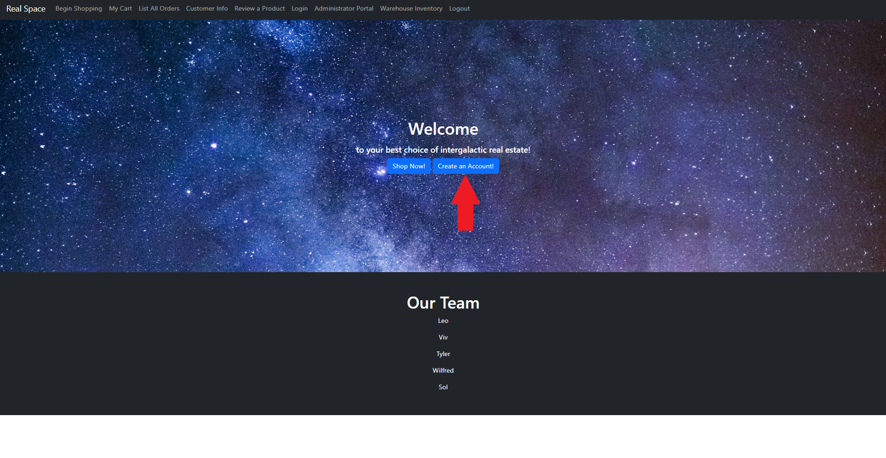


This page allows our customers to create accounts with us and gain access to some behind the scenes information we provide about our real estate products. When creating an account, you will be asked to input some information about yourself…


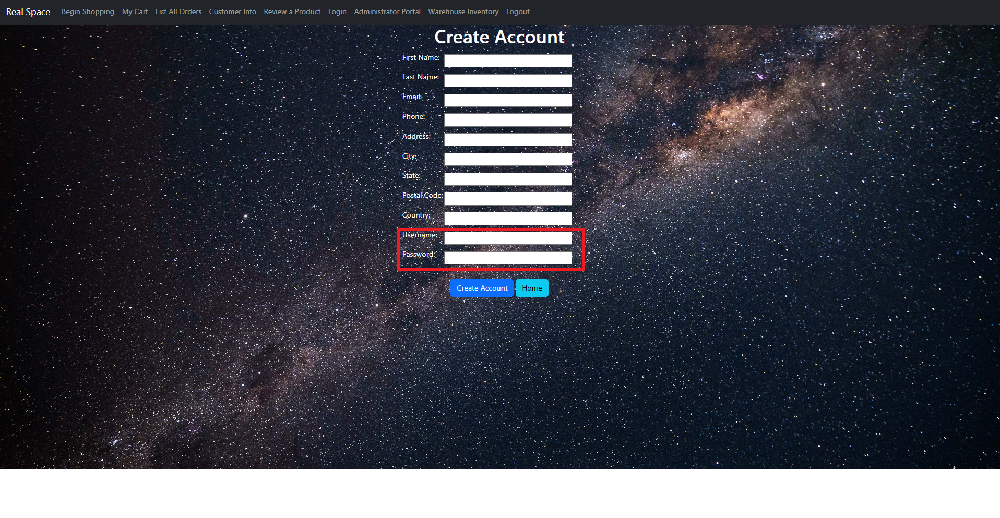


The user ID and password you create here will allow you to login to your account in the future...


Once you have created your account you can navigate to the Customer Info page where you can review your account information at anytime…


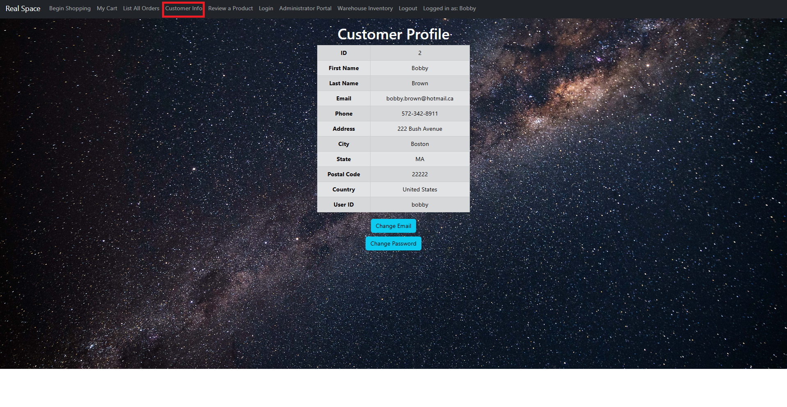


Furthermore, if at anytime you need to change your email or password, you can click on the button at the bottom of the page which will redirect you to a page where you can input your new email or password…


As a customer you are now automatically an administrator as well! Congratulations! With this authorization you are able to access another one of our pages called the Administrator Portal where you can see all customers who have created an account with us, as well as the daily sales we have made. You are also allowed to add a new product, update or delete a product, ship an order, add or update a warehouse or customer, and finally restore the database from the Admin Portal. Be careful not to add dangerous values, as there is no data validation when updating from the admin page. If things get hairy, run loaddata.jsp! As you can tell, we value security and privacy above all else.

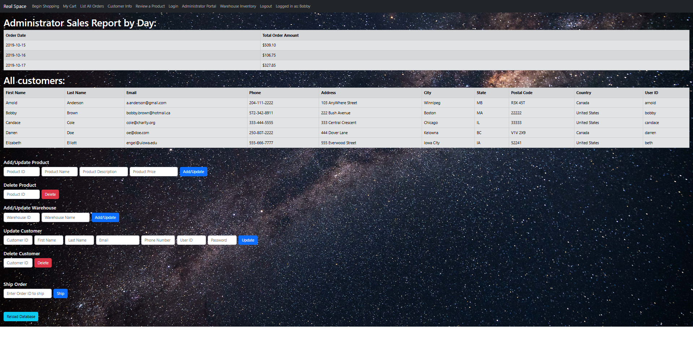


As an administrator, you can choose an order to ship. Doing so lands you on a page that tells you the new inventory for items in that order or displays an error if the order was not able to be fulfilled.

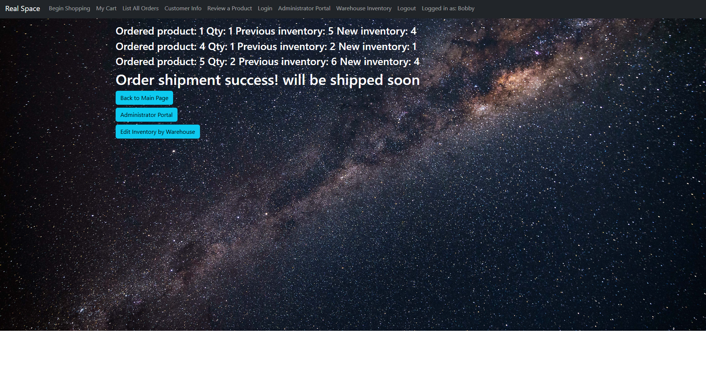


You are also allowed access into our Inventory Warehouse page which provides information on our current inventory in our main warehouse located on Mars. Not only are you allowed access, but you are also allowed to make changes to the quantity we have in store of each of our properties. Full control!


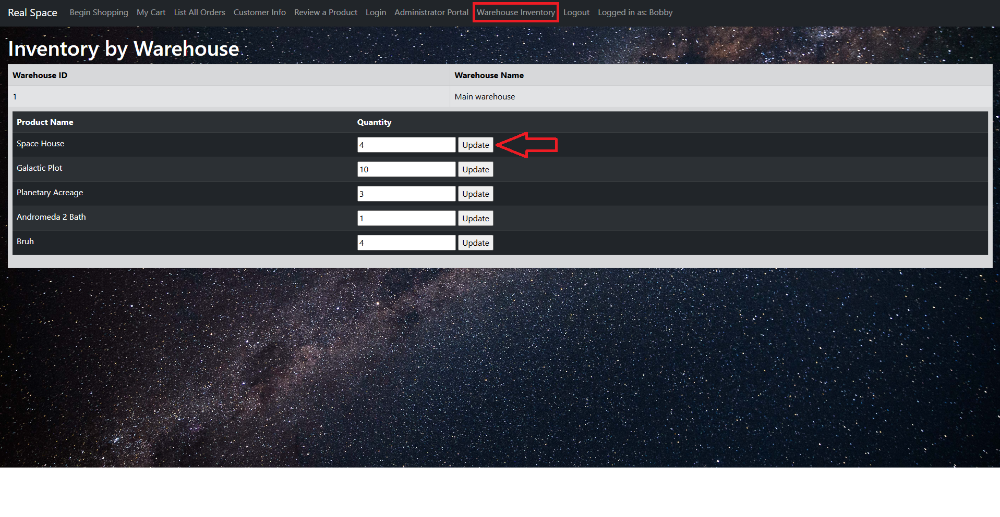


Now that we’ve seen the admin side of the website, let’s head on over to the shopping section. If you maneuver back to the home page you can click the other button that says shop now!


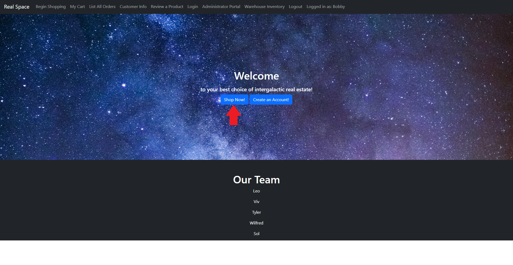


Our shopping page consists of all our real estate options with professionally taken pictures of the properties beside them, as well as an in-depth description of the property and its price…


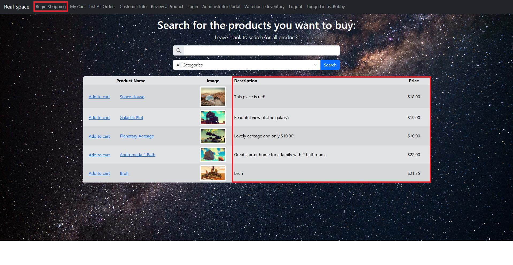


On this page you are able to browse for the products by specific categories that might help you narrow down your search. You are also able to search for any specific properties you have in mind prior to beginning your search…


Once you have chosen a property you are interested in purchasing, you will have the option to add it to your cart...


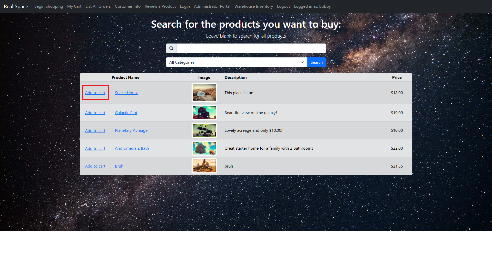

If you add it to your cart, you will be asked whether you'd like to continue shopping or check out...

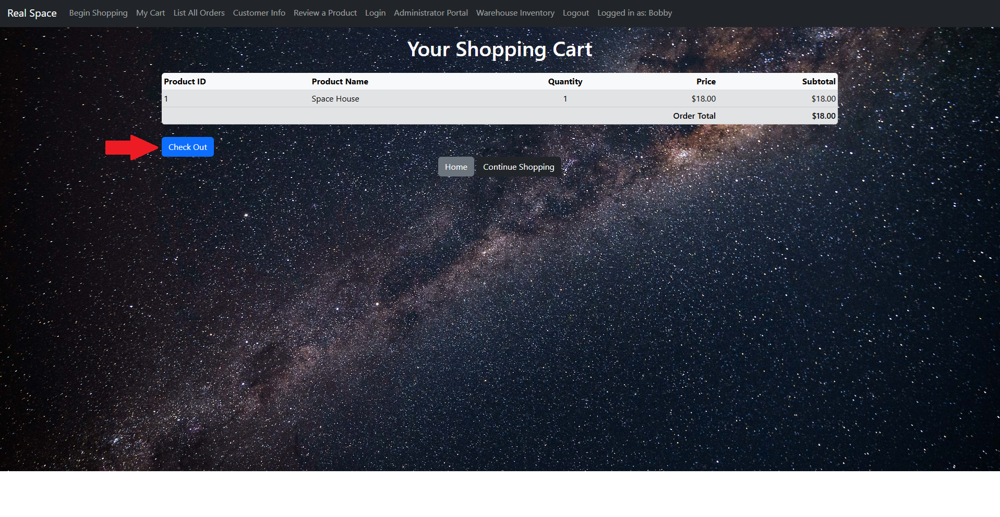

If you choose to proceed to checkout you will be required to input your username and password which you provided when you created an account with us. Note that if you do not have an account with us, or have not yet logged in, you will not be able to proceed to checkout…


Your order summary is then shown after your payment goes through, as well as some details about your reference number and shipping information…


As a customer on the website, you are also able to see a list of the prior orders that have been made by yourself and other customers at the page titled List All Orders. Again, we value the privacy of our customers dearly.


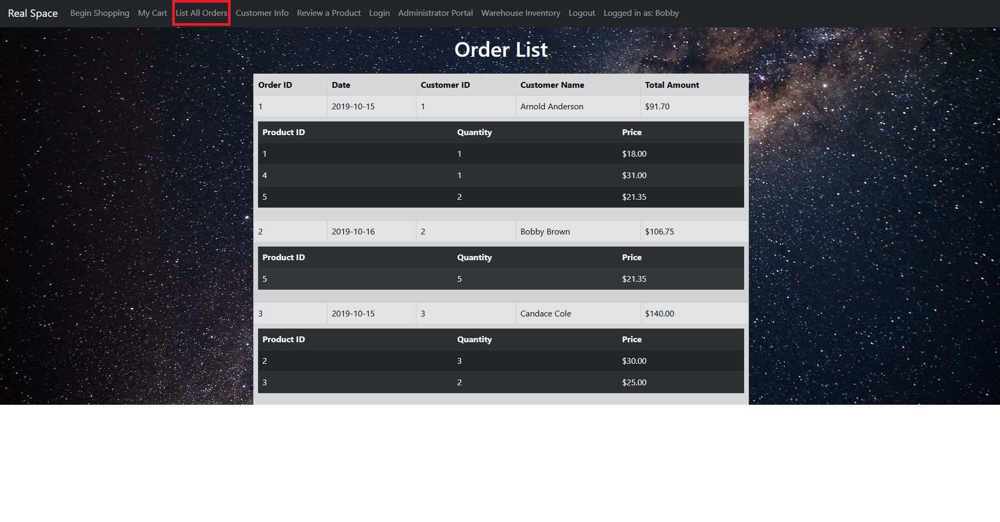


Once you have completed the first of many visits to our website, we give you the privilege of leaving our real estate properties a 5-star review at the page titled Review a Product. You’re welcome! We give the option of leaving a 1-5 rating, specifying the product ID of what you are rating, and leaving us a message on any thoughts you had regarding the product...


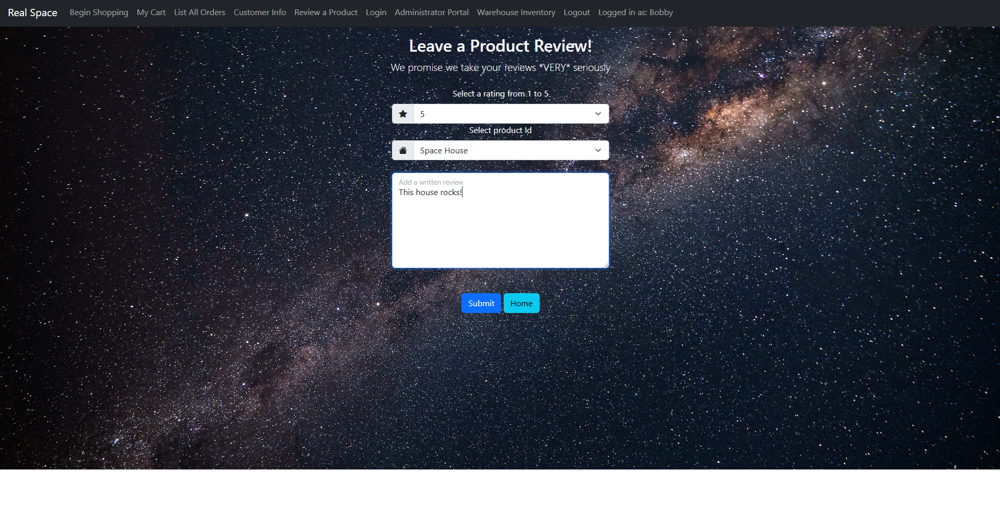


Once submitted, the next time you navigate back to that property on our website your rating and comment will appear below!


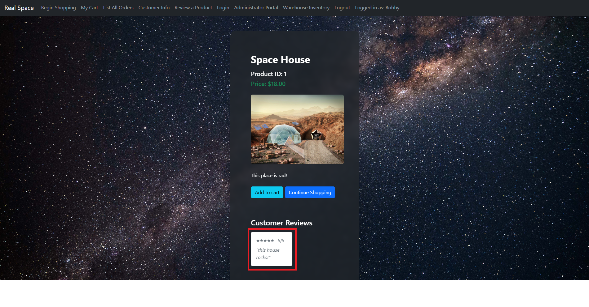


Now that you know how to navigate our website, go take a look for yourself! Happy shopping!